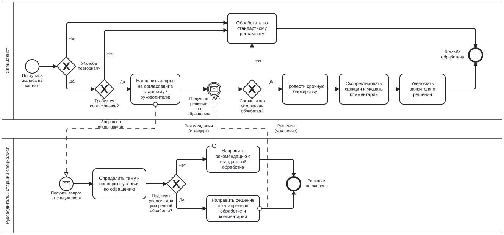
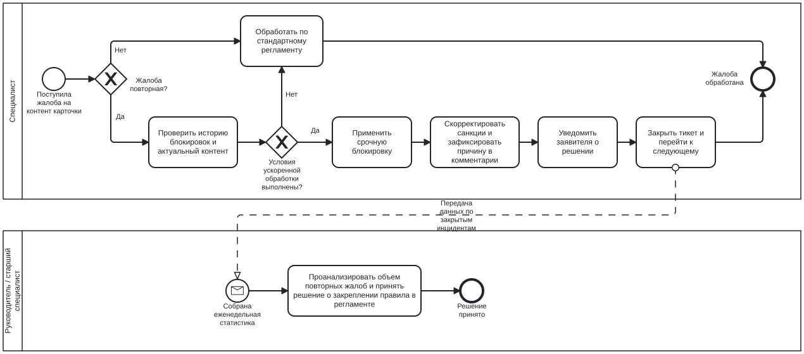

# Оптимизация обработки повторных жалоб на контент карточек товаров (BPMN As-Is / To-Be)

## 1. Контекст и бизнес-проблема
В операционном процессе модерации контента e-commerce участились повторные жалобы заявителей на карточки товаров, по которым ранее уже выносились решения. Часть продавцов обходила стандартные сроки устранения нарушений или возвращала проблемный контент после снятия ограничений.

### Что происходило в модели `AS-IS`:
- **Рост эскалаций:** при повторных обращениях и недовольстве заявителей сотрудники регулярно обращались за консультацией к старшим специалистам и руководителям.
- **Узкое горлышко и потеря потока:** руководители и старшие специалисты заняты задачами более высокого приоритета и отвечают с задержкой в несколько часов. Из-за этого задачи выпадали из потоковой обработки и зависали в ожидании решения.
- **Неоднородность решений:** не все сотрудники эскалировали спорные кейсы — часть обрабатывала их по базовому регламенту, что создавало риск повторных жалоб и репутационных издержек.
- **Ограничения интерфейса:** оперативная проверка истории всех промежуточных действий в интерфейсе была затруднена, поэтому анализ целесообразно строить по надежно фиксируемым фактам предыдущих блокировок и актуальному состоянию контента.

---

## 2. Цель и границы кейса
- **Цель:** сократить время обработки повторных жалоб, разгрузить старших специалистов и руководителей от рутинных согласований и унифицировать принятие решений.
- **В фокусе:** логика маршрутизации повторных жалоб, проверка условий ускоренной обработки, фиксация решения и регулярный контроль объема таких обращений.
- **Вне рамок текущего этапа:** доработка пользовательского интерфейса CRM/админки и изменение логики работы автоматических проверок системы.

---

## 3. Модель процесса `AS-IS`

Ключевые точки потери времени на схеме `AS-IS`:
1. Ручное согласование повторных обращений со старшими специалистами/руководителем.
2. Ожидание ответа в очереди, перевод задачи из потока в отложенный статус.
3. Разные подходы сотрудников при отсутствии единого алгоритма проверки.

---

## 4. Целевая модель `TO-BE` и бизнес-правила

### Бизнес-правила для процесса `TO-BE`:
- **01 (Определение повторности):** если жалоба поступает по карточке впервые — задача идет по стандартному регламенту.
- **02 (Проверка условий ускоренной обработки):** при повторной жалобе специалист проверяет историю предыдущих блокировок карточки и сопоставляет текущий контент с ранее зафиксированным нарушением.
  - Если контент изменился или условия не подтвердились — карточка направляется на стандартную обработку.
  - Если условия подтвердились — применяется ускоренная процедура блокировки без ожидания ручного согласования по каждому тикету.
- **03 (Фиксация и прозрачность):** специалист корректно оформляет меры воздействия, указывает причину/основание в комментарии, уведомляет заявителя и закрывает тикет.
- **04 (Контроль и масштабирование):** объем повторных жалоб агрегируется еженедельно, чтобы руководитель мог оценить эффект и принять решение о закреплении логики в постоянном регламенте.

---

## 5. Ожидаемый бизнес-эффект
- **Снижение нагрузки на старших специалистов и руководителей:** меньше типовых обращений в личку/чат по однотипным кейсам.
- **Сокращение времени цикла (Cycle Time):** тикеты не зависают в ожидании согласования на несколько часов и обрабатываются в рамках потока.
- **Единообразие решений:** понятные критерии проверки снижают зависимость результата от того, к какому именно старшему обратился сотрудник.
- **Управляемость:** еженедельная статистика дает основу для принятия решений на уровне регламентов.

---

## 6. Итог и артефакты в репозитории
- **Нотация моделирования:** BPMN 2.0 (дорожки ролей, эксклюзивные шлюзы `XOR`, события-сообщения и потоки сообщений между участниками).
- `as-is.svg` — текущая модель процесса в нотации BPMN 2.0.
- `to-be.svg` — целевая модель процесса в нотации BPMN 2.0.
- `README.md` — описание проблемы, бизнес-правил, ожидаемого эффекта и логики изменений.
